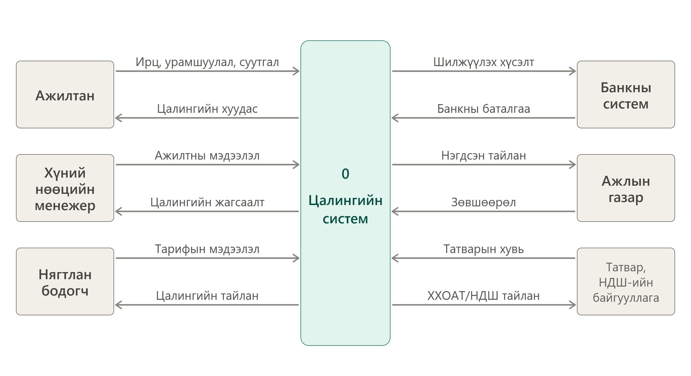
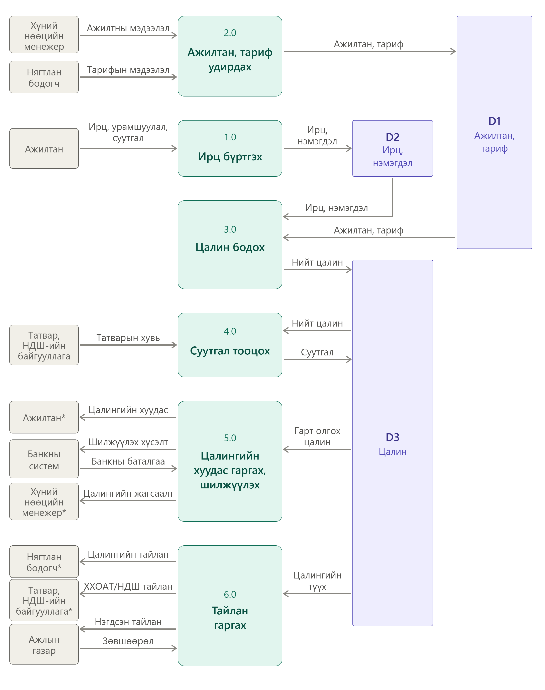
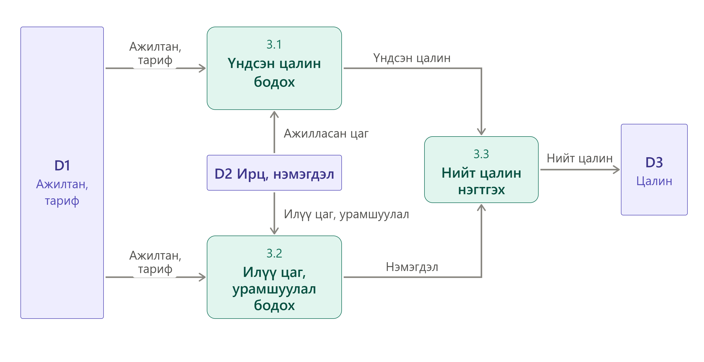

# SAD236 · Лаборатори 10 · Түвшинтэй DFD

Цалингийн системийн Context, Level 0, Level 1 өгөгдлийн урсгалын диаграмм.

## 1. Контекст диаграмм

## 2. Level 0 DFD

## 3. Level 1 DFD (3.0 Цалин бодох)

## Процесс ба сангийн хүснэгт

| Процесс | Оролт | Гаралт | Сан |
|---|---|---|---|
| 1.0 Ирц бүртгэх | Ирц, урамшуулал, суутгал | Ирц, нэмэгдэл | D2 (бичих) |
| 2.0 Ажилтан, тариф удирдах | Ажилтны мэдээлэл, Тарифын мэдээлэл | Ажилтан, тариф | D1 (бичих) |
| 3.0 Цалин бодох | Ажилтан, тариф; Ирц, нэмэгдэл | Нийт цалин | D1, D2 (унших), D3 (бичих) |
| 4.0 Суутгал тооцох | Нийт цалин, Татварын хувь | Суутгал | D3 (унших, бичих) |
| 5.0 Цалингийн хуудас гаргах, шилжүүлэх | Гарт олгох цалин, Банкны баталгаа | Цалингийн хуудас, Шилжүүлэх хүсэлт, Цалингийн жагсаалт | D3 (унших) |
| 6.0 Тайлан гаргах | Цалингийн түүх, Зөвшөөрөл | Цалингийн тайлан, ХХОАТ/НДШ тайлан, Нэгдсэн тайлан | D3 (унших) |

## Тэнцвэржүүлэлт: Контекст ↔ Level 0

| Урсгал | Контекст | Level 0 | Дүгнэлт |
|---|---|---|---|
| Ирц, урамшуулал, суутгал | Ажилтан → 0 | Ажилтан → 1.0 | Нийцсэн |
| Цалингийн хуудас | 0 → Ажилтан | 5.0 → Ажилтан | Нийцсэн |
| Ажилтны мэдээлэл | Хүний нөөц → 0 | Хүний нөөц → 2.0 | Нийцсэн |
| Цалингийн жагсаалт | 0 → Хүний нөөц | 5.0 → Хүний нөөц | Нийцсэн |
| Тарифын мэдээлэл | Нягтлан → 0 | Нягтлан → 2.0 | Нийцсэн |
| Цалингийн тайлан | 0 → Нягтлан | 6.0 → Нягтлан | Нийцсэн |
| Татварын хувь | Татвар, НДШ → 0 | Татвар, НДШ → 4.0 | Нийцсэн |
| ХХОАТ/НДШ тайлан | 0 → Татвар, НДШ | 6.0 → Татвар, НДШ | Нийцсэн |
| Шилжүүлэх хүсэлт | 0 → Банк | 5.0 → Банк | Нийцсэн |
| Банкны баталгаа | Банк → 0 | Банк → 5.0 | Нийцсэн |
| Нэгдсэн тайлан | 0 → Ажлын газар | 6.0 → Ажлын газар | Нийцсэн |
| Зөвшөөрөл | Ажлын газар → 0 | Ажлын газар → 6.0 | Нийцсэн |

## Тэнцвэржүүлэлт: Level 0 ↔ Level 1 (3.0)

| Урсгал | Level 0 (3.0) | Level 1 | Дүгнэлт |
|---|---|---|---|
| Ажилтан, тариф | D1 → 3.0 | D1 → 3.1, D1 → 3.2 | Нийцсэн |
| Ирц, нэмэгдэл | D2 → 3.0 | D2 → 3.1 (Ажилласан цаг), D2 → 3.2 (Илүү цаг, урамшуулал) | Нийцсэн |
| Нийт цалин | 3.0 → D3 | 3.3 → D3 | Нийцсэн |
| Үндсэн цалин, Нэмэгдэл | — | 3.1 → 3.3, 3.2 → 3.3 | Дотоод урсгал |
